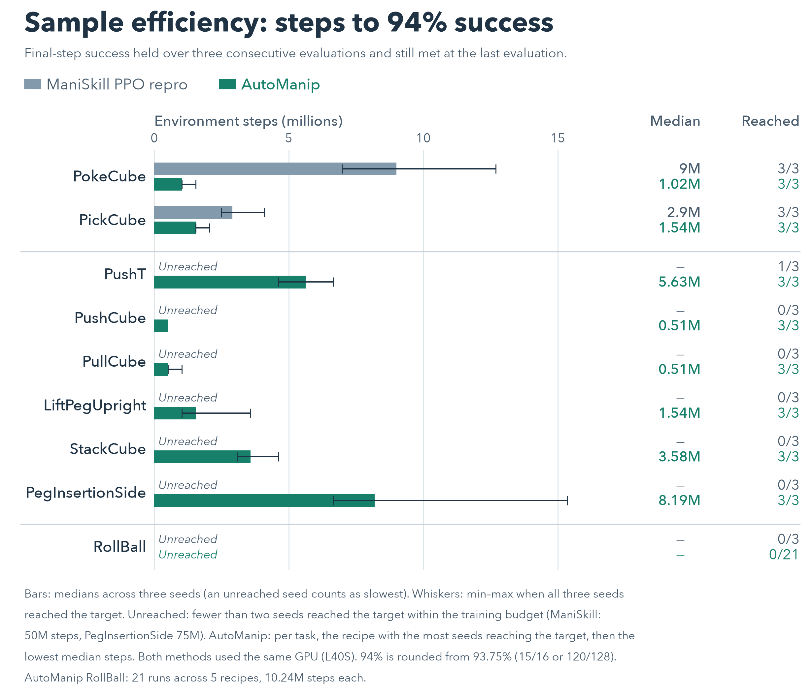
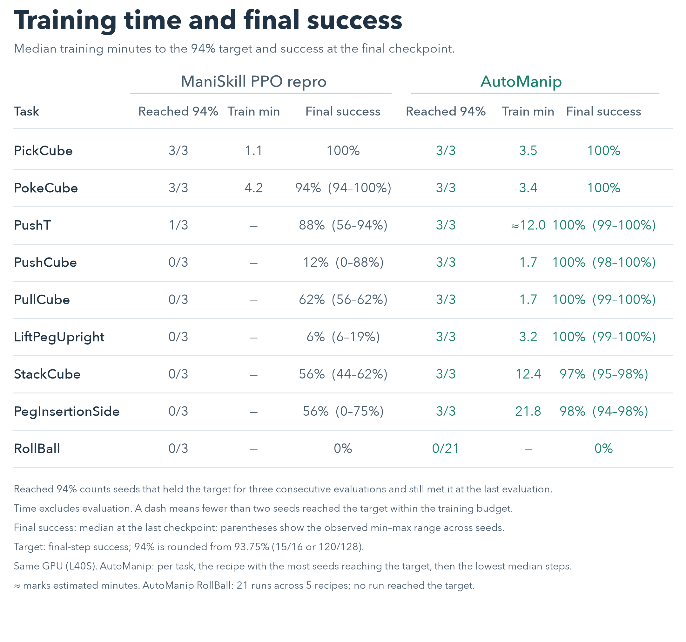

# Where robotics is heading

*November 17, 2026*

I see the field of robotics shifting in two major ways.

First, AI will do most of the robotics research. There are reports of AI already assisting R&D for building AI models. [According to OpenAI](https://openai.com/index/research-acceleration-view-inside-openai/), they hit their milestone for an autonomous research intern in September 2026 and predict that they will create an automated AI researcher by early 2028. This would apply to robotics as well, and we will witness agents coming up with novel algorithms to solve robotics tasks under a multitude of constraints, such as edge inference and sample efficiency.

Second, frontier models can directly perform robotics tasks. Astra was the first major release in this direction in September 2026, and other labs have since followed suit. We will distill these models into cheaper models and use deployment data to improve them. The focus is shifting from large-scale human data collection to simulation-driven data generation and iteration (real-to-sim-to-real).

Having had some hands-on experience with the second point, I wanted to investigate how good agents are at robotics research.

Similar to [Karpathy's autoresearch](https://github.com/karpathy/autoresearch), I wanted to assess how far I could get if I allowed an agent to conduct multiple quick experiments on manipulation tasks.

## Summary of Findings

To be able to conduct a lot of experiments in quick succession, I wanted to pick tasks that are known to get solved quickly in simulation.

I used [ManiSkill](https://github.com/haosulab/ManiSkill), a GPU-parallel robot simulator that has tasks like picking up a cube, stacking two cubes, inserting a peg into a hole, and so on. ManiSkill reports that their simplest task, state-based PickCube, [can be solved in about a minute](https://maniskill.readthedocs.io/en/v3.0.0b21/user_guide/demos/gallery.html) on GPUs like RTX 4090.

I started with a slightly more challenging task, StackCube, that involves picking up a cube and placing it on another cube. The agent started with the [example PPO code](https://github.com/haosulab/ManiSkill/tree/main/examples/baselines/ppo) in the ManiSkill repository. The agent's task was to get as close to 95% performance as possible. For this task, the reward functions or the network architecture were not changed.

The agent went through about 50 experiments (10 to 25 mins each). The experiments listed below moved the needle most significantly. Every run is in the [experiment ledger](../../docs/experiment-ledger.md).

| Modification | Evaluation success |
| --- | --- |
| Official PPO baseline | 31.5% |
| Increase discount factor from 0.8 to 0.9 | 71.1% |
| Add entropy regularization (0.003) | 83.6% |
| Continue episodes after first success | 94.0% |

Prior to the last modification above, the agent discovered that 98.4% of episodes achieved success at least once, but only 83.6% remained successful at the final timestep. The official trainer terminated episodes upon first success, whereas our evaluator continued through the full 50-step horizon.

Removing early termination allowed the policy to experience the consequences of its actions after completing the stack.

The resulting policy achieved 94.1% success on separate confirmation episodes, with approximately 17.8 minutes of training per seed on an L4 GPU.

This first phase demonstrated that an AI agent could substantially improve a robot-learning baseline. However, most of the gains came from conventional RL tuning and correcting training-evaluation mismatches, nothing truly novel.

After experimenting with a few more tasks, I asked the agent to shift focus to sample efficiency once high performance (≥94%) on a task was achieved. Over the course of 5 days, during which I mostly just approved experiments and occasionally prioritized certain runs, Claude conducted about 525 training runs at a cost of about $475. Each batch was written down with its predictions before it ran, in the [sample-efficiency plan](../../docs/sample-efficiency-plan-20261031.md), and the [results](../../docs/sample-efficiency-results-20261031.md) are summarized separately.

For sample efficiency, substantial gains came from heavy experience reuse in TD3 (16 updates per simulator step) and scaling the discount factor with episode length. Additional gains came from diagnosing failures and incorporating tricks like penalizing actions outside valid limits and adding a minimum exploration probability (2%) to the gripper. For wall-clock efficiency, improvements stemmed from using CUDA graphs, applying 4 updates per step, and a tuned optimizer (AdamW). Running more robots in parallel helped only slightly on PickCube and slowed PokeCube.

The agent also attempted to reproduce ManiSkill's results using their published configs; the comparison below contrasts those results with AutoManip's. "Unreached" indicates that the system never reached the target ≥94% performance threshold (93.75%, held over three consecutive evaluations and still met at the last evaluation).

While the results are quite strong, I was more interested in a few meta-level questions:

## Does the agent improve at solving tasks over time by transferring knowledge?

Yes. Below are several examples of applying learnings from one task to another.

### Where Transfer Helped

Applying the unmodified TD3 setup from StackCube to unseen tasks yielded significant gains:

- PokeCube required roughly 10× fewer environment steps while also reducing runtime in minutes.
- PickCube saw a 2× reduction in required steps.
- LiftPegUpright achieved a 1.7× sample efficiency boost.
- PushT and PullCubeTool hit 99-100% performance, solving PushT where PPO previously failed (PPO reached 62-89% on PullCubeTool).

The minimum gripper exploration probability proved beneficial for environments requiring an object release upon completion.

- Developed during StackCube experiments, the mechanism transferred successfully to PlaceSphere.
- For LiftPegUpright, further analysis revealed the overall improvement stemmed primarily from higher update frequency rather than the exploration floor.
- Since PickCube lacks a release phase, the addition had no effect.
- Prior to running PokeCube, the agent correctly anticipated that the floor would offer no benefit, which aligned with experimental results.

Scaling the discount factor alongside the episode horizon was evaluated on PegInsertionSide (100 steps). Increasing discount to 0.95 boosted performance from 47-70% up to 95-98% (in later runs, 1 of 9 seeds never succeeded). When applied to the novel RollBall task, the heuristic automatically selected 0.94, increasing target reaching frequency by 3 to 5×, but no run learned to stop the ball at the goal, so success at the end of the episode stayed at 0%.

I also spun up two new agents for a bimanual manipulation task. The agent equipped with a ledger documenting prior experiments (including which configurations succeeded or failed and the underlying rationale) immediately adopted the optimal recipe (TD3 + CUDA graphs, high discount factor, etc.) and reached 95% success at 5.5M steps, compared to 33.1M steps without the ledger: 6× greater sample efficiency. This was one session per agent, measured on development episodes only.

Thus, cross-task transfer of strategies and hyperparameter insights substantially improved sample efficiency, enabling the agent to solve increasingly difficult tasks far more rapidly than baseline methods.

## Does the agent improve at research when given time to read papers and conduct experiments?

It did not invent anything novel, despite repeated encouragement. Instead, it generated hypotheses and conducted experiments to validate or invalidate them. Although nearly half of its predictions proved false, it meticulously logged all findings.

So while publicly available models aren't there yet, we have evidence that labs are working on developing models that can do scientific research, and I expect that it would accelerate robotics deployments.
