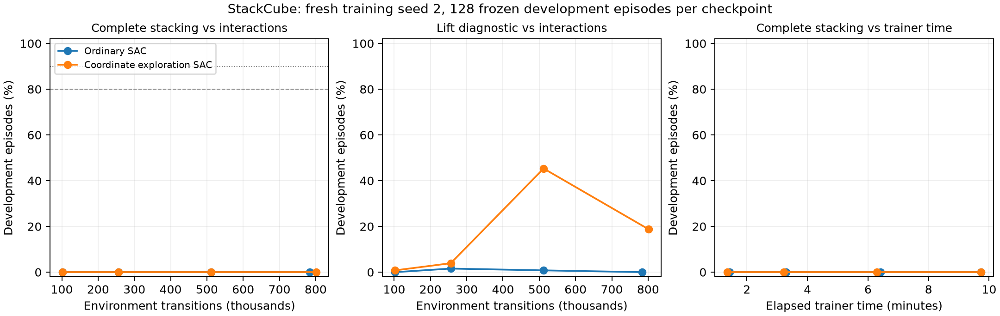

# Fresh-seed SAC curves: better lifting, no learned stacking

The full-task hypothesis failed. Both fresh training-seed2 learners completed
normally under their ten-minute ceilings and scored **0/128 final stacks at every
preregistered development checkpoint**. Coordinatewise exploration improved
intermediate skills at512k, but neither solved release/stacking. No promotion,
confirmation query, extension or automatic additional training follows this study.

| Collector | Transitions | Grasp /128 | Lift /128 | Transport /128 | Placement /128 | Final stacks /128 |
|---|---:|---:|---:|---:|---:|---:|
| Ordinary low-alpha SAC |102,400 |69 |0 |0 |0 |0 |
| Ordinary low-alpha SAC |256,000 |105 |2 |1 |0 |0 |
| Ordinary low-alpha SAC |512,000 |112 |1 |0 |0 |0 |
| Ordinary low-alpha SAC |783,936 terminal |53 |0 |0 |0 |0 |
| Coordinate exploration SAC |102,400 |50 |1 |0 |0 |0 |
| Coordinate exploration SAC |256,000 |113 |5 |2 |0 |0 |
| Coordinate exploration SAC |512,000 |126 |58 |41 |2 |0 |
| Coordinate exploration SAC |801,472 terminal |124 |24 |17 |1 |0 |

Release, contact-free placement and ten-step stack stability were zero throughout.
Diagnostics record whether a stage occurred; final-stack success is the frozen
end-of-episode task metric. These are not interchangeable performance measures.

Lines join measured checkpoints; intermediate behavior is unobserved. Neither
T80 nor T90 was observed through either terminal checkpoint. This does not
establish the absence of temporary crossings between checkpoints. Detailed
observed-threshold records include step/time bounds and clock qualifications.

## Registered decision and what changed our beliefs

The exact512,000-step primary comparison has matched31,688 critic and10,562
actor/temperature updates. Coordinate needed at least64 stacks and a lead of20;
it scored zero, meeting the registered <=8 weak-sufficiency result. Later policies
cannot rescue this primary. The unexpectedly improved lift/transport stages are
secondary evidence, not improved complete-task sample efficiency.

The previous seed1 coordinate result at102.4k was34 lifts; fresh seed2 scored1.
The early lift signal did not replicate at its original step endpoint. However,
seed2 subsequently reached58 lifts and41 transports at512k, so the data do not
support saying the collector never helps. Nor do they isolate one mediator:
exploration changes visited states, learned actors, replay and temperature feedback.

Continued training did not preserve those gains. Coordinate lift fell58→24 and
transport41→17; ordinary SAC grasp fell112→53. These fixed-development observations
identify acquisition followed by regression as a useful unresolved phenomenon,
without proving whether the cause is exploration, value error, observation aliasing,
optimization or seed variability. Do not immediately turn this into another broad
SAC hyperparameter sweep.

PPO remains the proven complete-task reference. One historical L40S PPO control
scored98/128 at10.24M transitions after572.61 child seconds; the established50M
recipe independently confirmed95.90% over three training seeds. Those historical
records differ in seed/recipe/step budget and are context, not a newly matched
algorithm race. The present SAC recipes have not earned a replacement claim.
Neither a10× gain nor a general learning principle has been established.

## Controls, clocks and accounting

Both learners started from identical random seed2 actors, online and target
critics, alpha and CPU/CUDA RNG arrays. No previous policy, diagnostic trajectory,
analytic controller or teacher entered learning. Actor/critic/target/temperature
objectives, original task/reward,48/8 interfaces,64 environments and update cadence
were unchanged. Ordinary SAC used the checked epsilon0 identity collector;
coordinate used epsilon.1. Candidate workers could not access scorer/private
seeds, credentials or network. Source hashes and safe actor checks passed.

| Run | Child process seconds | Terminal transitions | Terminal critic / actor updates | Stop |
|---|---:|---:|---:|---|
| Ordinary SAC |586.806 |783,936 |48,680 /16,226 |Deadline |
| Coordinate exploration |587.051 |801,472 |49,776 /16,592 |Deadline |

The dual ceiling was600 child seconds or1.024M transitions. An internal save
reserve stopped collection before the hard deadline. Both terminal policies had
partially completed final learner blocks: four fewer critic updates than an
uncensored block schedule. Their actual counters are preserved and labeled
update-censored; both512k primaries have full work. Checkpoint elapsed times
include initialization/export inside train(), but exclude module imports; child
process times above include imports and final export. Queue/image/scoring clocks
are separate. Different terminal step counts are not an equal-step comparison.

Additional training:1,585,408 transitions and1,173.857 combined child seconds.
Frozen development:8 once-only128-episode reports,1,024 episodes/51,200 transitions,
273.982 scorer-process seconds. Zero confirmation/private-final-holdout queries.
All stage failures and unsuccessful checkpoints remain in the archive.

The archived candidate inventory contains58 files/51,332,712 bytes; exact durable
score bytes, reviewed sources, numeric states, dispatch IDs and learning curves are
also preserved. Final hash manifest initially covered95 files/52,937,637 bytes.
Both app lifecycle/task reads confirmed STOPPED/zero tasks before closing the$3
reservation. Provider-reported campaign increment$0.92633839; total session
$15.17362686, remaining$84.82637314 of the original$100 cap, zero reservations.
Metering may lag. Scientific history now72 completed training runs/40 recorded
variant families; historical PickCube/PPO results remain unchanged.

Protocol:[registered plan](full-stacking-curve-plan-20261029.md).
Data:[aggregate and full curves](../runs/full-stacking-curve-20261029/reconciled-summary.json),
[raw archive manifest](../runs/full-stacking-curve-20261029/final-archive-manifest.json).
No further robot run is admitted by this report. Next work is a cheap, falsifiable
probe of why an acquired behavior regresses or fails to compose, with competing
explanations tested before another GPU method.
