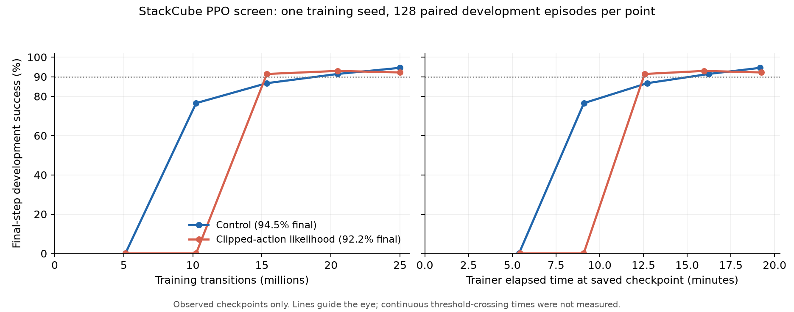

# Clipped-action PPO screen: do not expand this variant

The prespecified seed-1 screen did not pass its follow-up rule. The candidate
finished at **118/128 (92.19%)** development success versus **121/128 (94.53%)**
for its same-platform full-horizon PPO control. Its common-domain normalized
learning AUC was .56536 versus .74948. No additional training seeds or
confirmation queries are warranted under the declared rule.

This is one paired training seed, not evidence that CAPG is universally worse.
The independently confirmed three-seed reference remains unchanged at 94.08%.
The candidate adapts published
[Clipped Action Policy Gradient](https://proceedings.mlr.press/v80/fujita18a.html)
to PPO; it is not a new algorithm.

## Complete measured development curve

Each point uses the same frozen 128 development episodes and final-step success
definition. Neither the evaluator nor the task, physics, reward or interface was
changed. The training source digests and admission are in the linked plan.

| Training transitions | Control successes | CAPG successes |
|---:|---:|---:|
| 5,120,000 | 0/128 (0%) | 0/128 (0%) |
| 10,240,000 | 98/128 (76.56%) | 0/128 (0%) |
| 15,360,000 | 111/128 (86.72%) | 117/128 (91.41%) |
| 20,480,000 | 117/128 (91.41%) | 119/128 (92.97%) |
| 24,985,600 | 121/128 (94.53%) | 118/128 (92.19%) |

There is a mixed signal worth retaining: CAPG first **measured** above 90% at
15.36M transitions, versus 20.48M for control. The corresponding checkpoint-ready
times were 754.22 and 974.14 trainer seconds. These are sparse sampled observations,
not continuous first-crossing times or reliable estimates across training seeds.
Both methods first measured above 80% and 85% at the same 15.36M checkpoint.

The declared gate required either a normalized AUC advantage of at least .03 or
an earlier 85% checkpoint, together with at most three fewer final successes.
CAPG met the final-success guard exactly but neither improvement condition.
Its AUC difference was **-.18412**, integrated by trapezoids over the common
observed domain 5.12M–24.9856M and divided by that domain's length. No unobserved
zero-step performance or missing early curve was assumed. We retain the earlier
90% observation without replacing the screening rule after seeing results.

## Compute and reproducibility

| Quantity | Control | CAPG |
|---|---:|---:|
| Training seed | 1 | 1 |
| Actual GPU | NVIDIA L40S | NVIDIA L40S |
| Training transitions | 24,985,600 | 24,985,600 |
| Completed 51,200-transition rollouts | 488 | 488 |
| Trainer subprocess seconds | 1,152.07 | 1,157.16 |
| Trainer minutes | 19.20 | 19.29 |
| Built-in diagnostic evaluation transitions | 8,000 | 8,000 |
| Frozen development evaluation transitions | 32,000 | 32,000 |
| Exact optimizer-step count | unavailable | unavailable |
| Configured optimizer-step upper bound | 124,928 | 124,928 |

Each run stayed below its original 1,320-second cap, including child startup and
built-in evaluation. Each had 20 built-in evaluations totaling 160 episodes;
these diagnostics do not enter the protected learning curve. Five frozen
evaluations per method added 640 episodes each, scored after training. Setup,
queueing, conversion and evaluator runtime are separate from trainer runtime.
Actual reported CAPG-screen cost was **$1.68909**, possibly subject to meter lag,
below the $3 admission cap.

Pins: Torch2.6.0+cu124, ManiSkill3.0.0b21, SAPIEN3.0.0b1, NumPy1.26.4,
Gymnasium0.29.1. Frozen protocol SHA256:
`fe2cc5987576a84b7a66ae9c8c9c4099b688c682d5736c5388217f5372391764`.
Exact trainer source hashes remain those in the
[prespecified screen plan](stackcube-capg-screen-20261027.md).

The server restart did not interrupt either cloud coordinator, repeat training,
refresh a lease or repeat evaluation. The CAPG app stopped automatically after
completion with zero remaining containers. All 95 archived files (85,510,800
bytes), including native checkpoints, safe actor bundles and ten full development
reports, passed local hash and length verification. Summary SHA256:
`ccdde76f85f3d03c9273f9a1697da18132ba5e80cd4f4f6952821ebc356dc117`.

## What the diagnostics do and do not explain

The mathematically checked bounded-action estimator did not yield a better
overall learning curve in this run. Its toy variance result is not a guarantee
for PPO's clipped surrogate, entropy regularizer or KL-based update stopping.

The 10.24M checkpoint reveals a specific behavioral bottleneck rather than a
complete failure to learn: CAPG's stage diagnostics recorded grasp, lift,
transport and placement in **127/128** episodes, but release in **0/128**.
Control recorded release in 106/128 and final success in 98/128. CAPG's final
policy released in 128/128 episodes, with 10 classified as released but not stable
and 118 successful. Thus release emerged later in this run. These stage summaries
do not establish why it was delayed, nor prove every stage occurred in a single
monotone sequence. The existing stock reward already includes task stages; this
is not evidence that an additional release reward is missing.

Mean sampled action-component clipping was 11.95% control versus 14.84% CAPG
through 10.24M transitions, and 20.67% versus 27.38% after 15.36M. Those are
descriptive trajectory differences, not proof that clipping caused the delayed
takeoff. In particular, successful gripper commands can correctly saturate.
Actor-gradient norms were not consistently smaller with CAPG early in training;
we did not measure gradient-estimator variance directly.

The likelihood change also affects PPO ratios and the KL stopping calculation.
The unchanged payload records KL and update time but not exact optimizer-step
counts. A configured eight epochs times 32 minibatches is only an upper bound;
KL can stop updates early. We cannot isolate a variance mechanism or equal-update
effect from these logs. Any future PPO mechanism test should include exact update
accounting before launch, rather than inferring it from configured epochs.

Decision artifacts are under `runs/stackcube-capg-screen-20261027/`:
`screen-decision.json`, `curve-summary.json`, `training-diagnostic-summary.json`,
`development-diagnostic-summary.json`, `learning-curves.png/pdf`, `summary.json`,
and `archive-manifest.json`.
The separate SAC control screen continues under its own unchanged admission.
