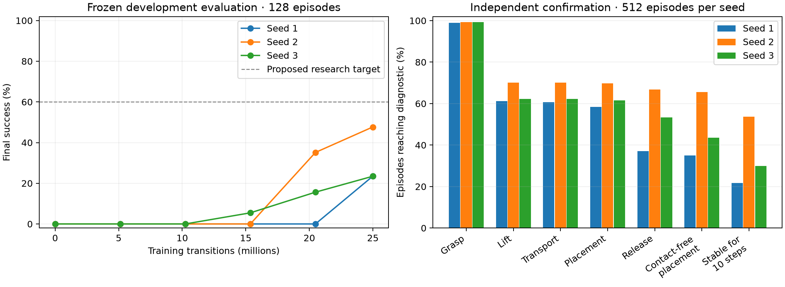

# StackCube official PPO: results and next experiments

The unchanged ManiSkill v3.0.0b21 25M-step PPO example achieved **32.2% mean
confirmation success** across three random-initialization training seeds.
Development averaged **31.5%**. No autonomous optimization has started.

| Training seed | Actual transitions | Training process time | Development | Confirmation | Confirmation Wilson 95% interval |
| --- | ---: | ---: | ---: | ---: | ---: |
| 1 | 24,985,600 | 22.0 min | 30/128 = 23.4% | 115/512 = 22.5% | 19.1–26.3% |
| 2 | 24,985,600 | 24.3 min | 61/128 = 47.7% | 244/512 = 47.7% | 43.4–52.0% |
| 3 | 24,985,600 | 24.7 min | 30/128 = 23.4% | 136/512 = 26.6% | 22.9–30.6% |

There were no evaluation execution failures. Total training was 74,956,800
transitions and 70.9 process minutes. Times include startup and official in-loop
evaluation, with up to five seconds of process-polling granularity. Post-training
independent evaluation and diagnostic replays are separate. Episode intervals
condition on each trained policy; they do not capture uncertainty across future
training seeds. Seed variation is substantial.

[Training-time curves](../runs/stackcube-20261026/report/learning-by-training-time.png),
[machine-readable report](../runs/stackcube-20261026/report/report.json), and
[frozen protocol and exact recipe](stackcube-baseline.md).
Success was still improving near the end of the budget. None of the preselected
independent development checkpoints reached 50% success.

## What the diagnostics show

These are **ever-reached** rates across 1,536 confirmation episodes, not a strict
ordered funnel. Definitions were frozen before training.

| Diagnostic | Episodes | Rate |
| --- | ---: | ---: |
| Grasp | 1,523 | 99.2% |
| Lift at least 3 cm | 991 | 64.5% |
| Transport proxy | 989 | 64.4% |
| On-top geometry | 971 | 63.2% |
| On top and non-grasping | 805 | 52.4% |
| Contact-free placement | 738 | 48.0% |
| Ten consecutive stock-success steps | 539 | 35.1% |
| Stock success at final step | 495 | 32.2% |

Stock success occurred at some point in **49.3%** of confirmation episodes.
The decrease to 32.2% at the end identifies a persistence problem as well as a
lifting problem. The first-unmet-stage labels were dominated by grasp without
sufficient lift (532 episodes), placement while still grasped (166), release
without ten consecutive success steps (194), and loss of previously sustained
stock success (116). These categories describe observations, not causes.

Additional development replays matched all **384/384** original episode
diagnostics. They provide every control step's actions, stage flags, cube
positions and reward components. All seven video replays also matched, passed
51-frame decoding checks, and used an observer camera without adding policy inputs.

The trajectories qualify the failure labels. At the final development frame,
165 episodes lacked on-top geometry, 48 were on top but still grasped, and 50
were on top and released but failed the velocity criterion. Of those 50, 45
exceeded the linear-speed threshold and 29 exceeded the angular-speed threshold;
these groups overlap. All 33 development episodes labelled
`lost_stack_before_horizon` still had on-top geometry: 29 failed velocity checks
and four were grasped again. That label means loss of **stock success**, and
does not establish that the cube fell.

Examples worth inspecting:

| Replay | Observation | Artifacts |
| --- | --- | --- |
| Successful stacks, seeds 1/2/3 | Each policy can complete the sequence | [1](../runs/stackcube-20261026/diagnostics/seed-1-dev-1-success.mp4), [2](../runs/stackcube-20261026/diagnostics/seed-2-dev-2-success.mp4), [3](../runs/stackcube-20261026/diagnostics/seed-3-dev-1-success.mp4) |
| Grasp without lift | Cube stays near table height while gripper command remains near −1 | [Video](../runs/stackcube-20261026/diagnostics/seed-1-dev-0-grasped_not_lifted.mp4), [trace](../runs/stackcube-20261026/diagnostics/seed-1-dev-0-grasped_not_lifted-trace.png) |
| Placement while grasped | Gripper command remains −1 after on-top geometry is reached | [Video](../runs/stackcube-20261026/diagnostics/seed-1-dev-16-placed_still_grasped.mp4), [reward branches](../runs/stackcube-20261026/report/seed-1-dev-16-placed_still_grasped-reward-branches.png) |
| Released, intermittent static success | Final linear speed 0.0169 m/s and angular speed 2.59 rad/s exceed stock limits | [Video](../runs/stackcube-20261026/diagnostics/seed-1-dev-3-released_not_stable.mp4), [trace](../runs/stackcube-20261026/diagnostics/seed-1-dev-3-released_not_stable-trace.png) |
| Loss of stock success | Final XY gap 3 mm and linear speed 0.001 m/s; angular speed 0.691 rad/s exceeds the 0.5 limit; both finger forces are zero | [Video](../runs/stackcube-20261026/diagnostics/seed-1-dev-48-lost_stack_before_horizon.mp4), [trace](../runs/stackcube-20261026/diagnostics/seed-1-dev-48-lost_stack_before_horizon-trace.png) |

Videos are deliberately selected examples, not a representative performance
sample. [Chronological histories](../runs/stackcube-20261026/diagnostics/stage-history-summary.json)
and [replay analysis](../runs/stackcube-20261026/report/diagnostic-analysis.json)
cover all development episodes. The three compressed `seed-N-development-steps.jsonl.gz`
files contain the full per-step records. These are post-training replays, not
instrumentation added to the official trainer.

## Proposed next experiments

The stock reward already encourages placement, opening and stillness; lifting
is implicit in its 3D target. The traces support testing longer credit assignment,
a temporary lift curriculum, more precise alignment/settling incentives, and
preserving exploration. Keep architecture fixed initially. A separate longer-budget
control would test whether the late-rising curves mainly reflect undertraining.

The target is **60% average success at the same transition budget**. The
[research plan](stackcube-research-plan.md) defines these hypotheses and separates
fixed-step from fixed-time comparisons. Screen on development episodes and reserve
fresh confirmation episodes for promotion. No candidate optimization has started.

## Artifacts and resource state

Validated actor-only references are under
[`checkpoints/stackcube-reference-20261026`](../checkpoints/stackcube-reference-20261026).
The original PickCube reference's 14 files still match their preserved hashes.
PickCube comparisons also involve different controllers and training budgets;
the earlier ten-minute runs did not measure earliest time to high success.

Pod `sptbqb2mwe2ed7` is **EXITED**, verified through Runpod after the independent
supervisor downloaded and hash-checked the 112.6 MB archive. The shared network
volume is retained. The start-to-stop-confirmation interval was about 97 minutes;
at the quoted $0.59/hour that suggests roughly $0.96 GPU rental, excluding storage.
The [billing snapshot](../runs/stackcube-20261026/report/resource-state.json)
currently posts $0.4096 for the Pod and has no 22:00 hour bucket, so it is not
treated as the final reconciled charge. Shared-volume day-to-date billing is
also recorded separately rather than attributed entirely to this campaign.

All 44 local CPU tests passed; the original GPU upload passed 38 tests, followed
by real CUDA preflight, official smoke/training, safe checkpoint conversion,
independent evaluation and the diagnostic replay checks described above.
