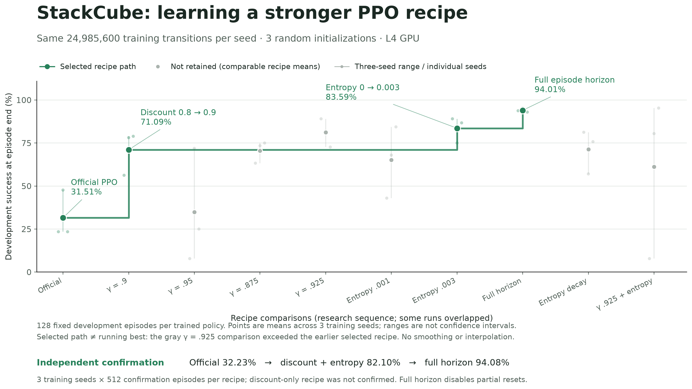
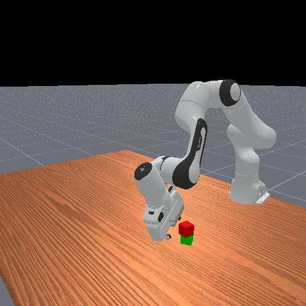

# StackCube PPO: 32.2% → 94.1% with three recipe changes

Personal experiment notes from AutoManip: state-based ManiSkill `StackCube-v1`,
random initialization, three training seeds, about 25M transitions per seed.
The official PPO implementation, task and reward stayed unchanged. This is a
recipe result, not a new RL algorithm or a sample-efficiency breakthrough.

## The entire learning-recipe diff

```diff
- "gamma": 0.8,
- "ent_coef": 0.0,
- "partial_reset": true
+ "gamma": 0.9,
+ "ent_coef": 0.003,
+ "partial_reset": false
```

[Actual patch](recipe.diff). Inspect the two local history points with
`git diff official-baseline improved-recipe -- recipe.json`.
The recipe commit changes exactly three lines; `ppo.py` is byte-identical
between those tags. These commits are a new explanatory extraction, not the
chronological research history.

- **Discount .8 → .9:** increases the weight of later rewards during learning.
- **Entropy 0 → .003:** adds an incentive to maintain stochastic exploration.
- **Full-horizon training:** keeps each training episode running for its normal
  50 steps after temporary success, matching final-step evaluation more closely.
  The task's success rule and episode horizon are unchanged.

Those are explanations of what the settings do, not proof of the complete causal
mechanism. They interact. The intermediate combined-discount/entropy result is
included below; this small repository is not a full factorial ablation study.

## Historical results

Each row has training seeds 1, 2 and 3, with **24,985,600 actual transitions per
seed** on NVIDIA L4. A 25M request is floored to 488 complete 51,200-step rollouts.

| Recipe | Development mean | Independent confirmation mean | Mean trainer minutes/seed |
|---|---:|---:|---:|
| Official example (.8 / 0 / success resets) | 31.51% | **32.23%** | 23.64 |
| Discount .9 + entropy .003, success resets | 83.59% | 82.10% | 22.44 |
| Above + full-horizon training | 94.01% | **94.08%** | 17.82 |

Final full-horizon confirmation counts are **478/512, 483/512 and 484/512**.
Official counts are **115/512, 244/512 and 136/512**. All exact per-seed times,
steps and development/confirmation counts are in [results.csv](results.csv).
The remembered “34%” starting point is 32.23% for this three-seed confirmation
comparison. No best-checkpoint selection was used.

Development used 128 fixed episodes per policy; confirmation used a separate
fixed set of 512 episodes, independently scored in the parent AutoManip project.
These sets are shared across policies, so the pooled counts are descriptive;
they are not independent samples across training seeds. Confirmation is not a
private final holdout. The three seeds provide limited evidence about variance.

Training times include startup and built-in diagnostics; independent scoring
is additional. Runs occurred in different batches on the same GPU class; final
recipe runs had a 22-minute ceiling and all reached the transition budget.
This supports a matched-transition recipe comparison, not an isolated hardware
or wall-time speedup claim. Extra audit/deadline instrumentation used in the
parent runs is omitted here. It stripped back to the same upstream PPO source.

The broader AutoManip objective—dramatically better from-scratch sample
efficiency—is still unresolved. Later 50M results and assisted-learning probes
are outside this small record.

## Progress figures and final-policy video



**Matched transitions:** selected recipe means improve 31.51% → 71.09% → 83.59% → 94.01% on development. Green shows the selected recipe path; gray shows comparable recipes not retained. This is not a formal running best. Each recipe has three training seeds, 24,985,600 transitions per seed and 128 fixed development episodes per policy. The main scientific comparison remains this matched-transition figure, rather than an identical wall-time claim.

[SVG](assets/stackcube-progress-25m.svg) · [PDF](assets/stackcube-progress-25m.pdf) · [aggregate data](assets/progress-data.json)

[22-minute availability figure](assets/stackcube-observed-by-22min.png) ([SVG](assets/stackcube-observed-by-22min.svg), [PDF](assets/stackcube-observed-by-22min.pdf)): latest eligible existing scored checkpoints across equivalent recipe records by 1320 training seconds. Entropy uses timed reruns with identical final policy digests; official and discount-only recipes still mix checkpoint steps. This is not an exact 22-minute endpoint evaluation, and no scores are interpolated. [Timestamp/source data](assets/timing-checkpoints.json) and [figure notes](assets/figure-notes.md) explain the limits.

[](assets/stackcube-full-horizon-25m-public-success.mp4)

**[Watch the final 25M policy stack the cubes](assets/stackcube-full-horizon-25m-public-success.mp4).** Training seed 1, full-horizon recipe, 24,985,600 transitions; this is not the later 50M policy. The illustrative clip is the first terminal-success episode in a declared order of eight fresh public seeds. Rendering used 400 public simulator transitions, zero new training transitions and zero protected benchmark queries. This selected illustration is not a benchmark or representative sampling estimate. [Render receipt](assets/render-receipt.json) records the policy/video hashes and selection rule; the historical scores above were not rerun.

Figures can be rebuilt from the frozen aggregate JSON using `python scripts/plot_progress.py` (matplotlib and numpy). [Asset manifest](assets/asset-manifest.json) lists hashes and lengths. Nothing has been posted publicly from this local repository.

## Run

No cloud SDK, API key or orchestration service is needed. Training requires a
compatible Linux NVIDIA GPU, CUDA/Vulkan drivers and ManiSkill assets. State
observations do not make GPU physics CPU-compatible. First use may download
simulator assets/runtime components; setup time is separate from training.

The Dockerfile uses the same pinned PyTorch base and hash-locked Python
dependencies as the historical environment. This extracted Dockerfile has
**not** been built or GPU-tested yet; no new training was performed for this
publication extraction.

```sh
docker build -t stackcube-ppo .
mkdir -p runs
docker run --rm --gpus all -v "$PWD/runs:/workspace/runs" \
  stackcube-ppo python run.py --official --seed 1
docker run --rm --gpus all -v "$PWD/runs:/workspace/runs" \
  stackcube-ppo python run.py --seed 1
```

Repeat each recipe with `--seed 2` and `--seed 3`. Existing output directories
are refused so results are not accidentally overwritten. Both recipes start
from random initialization; there are no demonstration or pretrained weights.

Inspect either command using only Python's standard library, without a GPU:

```sh
python run.py --official --seed 1 --dry-run
python run.py --seed 1 --dry-run
```

For a new diagnostic evaluation of **your own** checkpoint, use the official
script in the same environment with a fresh public seed, for example:

```sh
python ppo.py --env-id StackCube-v1 --evaluate \
  --checkpoint runs/stackcube-recipe-seed-1/final_ckpt.pt \
  --num-eval-envs 128 --num-eval-steps 50 --seed 314159 \
  --no-capture-video --no-track
```

Its printed `success_at_end` is a fresh upstream diagnostic. It is not a replay
of the historical independent confirmation benchmark. This minimal extraction
does not include the parent's isolated evaluator or protected episode seeds.
No new independent-confirmation result is claimed for it.

## Files and provenance

- `ppo.py`: unchanged [official ManiSkill PPO](https://github.com/haosulab/ManiSkill/blob/6226567ce326625fa6eacf9aeb3f4008e4339f7e/examples/baselines/ppo/ppo.py).
- `run.py`: thin launcher; shared task/budget settings plus one recipe file.
- `official.json` / `recipe.json`: original and improved settings.
- `recipe.diff`: the complete three-setting improvement patch.
- `requirements/` / `Dockerfile`: recorded dependency locks and a compact setup.
- `results.csv` / `provenance.json`: aggregate historical evidence and digests.

Pinned ManiSkill **3.0.0b21**, upstream commit
`6226567ce326625fa6eacf9aeb3f4008e4339f7e`; Torch 2.6.0+cu124, SAPIEN3.0.0b1,
NumPy1.26.4 and Gymnasium0.29.1. Robot `panda_wristcam`, controller
`pd_joint_delta_pos`, state48/action8, horizon50. The wrist camera is not a policy
input. Stock StackCube success includes on-top geometry, static cube and no
official grasp; it is not a separate contact-free or prolonged-stability test.

The trainer source digest is checked by the launcher. Protected episodes,
individual benchmark reports, credentials, provider IDs and checkpoints are
excluded. See [NOTICE](NOTICE) and the upstream Apache2.0 [LICENSE](LICENSE).
